<div align="center">



# 🎵 NadaKu

**Dengarkan lagu penuh secara gratis, dan cari musik dari seluruh dunia.**
Gabungan dua sumber legal: **Audius** (lagu utuh) + **iTunes** (katalog terluas).

<a href="https://superrrkyy.github.io/nadaku/">
  
</a>
<a href="https://github.com/superrrkyy/nadaku">
  
</a>

<br/><br/>


</div>

---

## 🎼 Dua Sumber Musik, Satu Aplikasi

<table>
  <tr>
    <td align="center" width="50%">
      <div style="font-size:30px">🎧</div>
      <b>Audius — Lagu Penuh</b><br/><br/>
      <sub>
        Lagu <b>utuh</b>, diunggah langsung oleh artisnya.<br/>
        Gratis, legal, tanpa batasan wilayah.<br/>
        Ditandai badge hijau <b>PENUH</b>.
      </sub>
    </td>
    <td align="center" width="50%">
      <div style="font-size:30px">🔍</div>
      <b>iTunes — Katalog Terluas</b><br/><br/>
      <sub>
        Cari <b>artis mana saja</b> di dunia.<br/>
        Putar <b>preview resmi 30 detik</b> + info album.<br/>
        Ditandai badge kuning <b>30s</b>.
      </sub>
    </td>
  </tr>
</table>

> Keduanya **tanpa API key**, resmi mendukung CORS, dan langsung jalan dari browser HP.

---

## ✨ Sorotan

| | |
|:--|:--|
| ⚡ **Pemutar lengkap** | play/pause, prev/next, acak, ulang (1 lagu / semua), seek bar, volume |
| 📊 **Visualizer nyata** | spektrum audio asli lewat Web Audio API — otomatis pakai animasi kalau sumbernya membatasi |
| 📋 **Antrian lagu** | tekan satu lagu → seluruh daftar ikut masuk antrean, lanjut otomatis |
| ❤️ **Favorit** | simpan lagu di perangkat, tersimpan walau browser ditutup |
| 🎛️ **16 genre** | Electronic, House, Hip-Hop/Rap, Lo-Fi, Techno, Dubstep, Jazz, Reggae, dan lain-lain |
| 🔥 **Trending** | pilihan minggu ini, bulan ini, atau sepanjang masa |
| 📱 **Mobile first** | navigasi bawah, pemutar mini + layar penuh, nyaman satu tangan |

---

## 📱 Fitur per Halaman

**🏠 Beranda**
- Sambutan + tombol cepat ke pencarian
- ⏮️ **Lanjut Dengar** — lagu terakhir yang kamu putar
- 🔥 **Sedang Trending** (Minggu / Bulan / Sepanjang masa) + tombol **Putar semua**
- 🎛️ Jelajah 16 genre
- 🌙 Rekomendasi Lo-Fi buat santai

**🔍 Cari**
- Pencarian bebas: judul lagu, artis, atau album
- Hasil dibagi dua: **🎧 Lagu Penuh** dan **🎼 Katalog Lengkap (preview 30s)**
- Tab filter: `Semua` · `Lagu Penuh` · `Preview 30s`
- Mode genre lewat tautan seperti `#/cari?genre=House`
- Saran kata kunci & chip genre saat kolom masih kosong

**❤️ Favorit**
- Semua lagu yang kamu tandai, bisa diputar semua sekaligus

**🎧 Pemutar**
- Bilah mini di bawah + layar penuh dengan cover besar, visualizer, progress, volume, favorit, dan tautan sumber

---

## 🛠️ Teknologi

| Lapisan | Pilihan | Alasan |
|:--|:--|:--|
| Antarmuka | **React 18** + **TypeScript** | Komponen rapi & aman dari salah ketik |
| Styling | **Tailwind CSS 3** | Cepat, konsisten, ukuran kecil |
| Audio | **HTML5 `<audio>`** | Ringan, tidak perlu library pemutar |
| Visualizer | **Web Audio API** | Spektrum asli langsung dari audio |
| Build | **Vite 6** | Dev server instan |
| Data | **Audius API** + **iTunes Search API** | Gratis, tanpa API key, legal |
| Penyimpanan | **localStorage** | Favorit & volume tersimpan di perangkat |
| Deploy | **GitHub Actions → Pages** | Otomatis setiap push ke `main` |

<details>
<summary><b>📂 Struktur folder</b></summary>

```
nadaku/
├── .github/workflows/deploy.yml   # deploy otomatis ke GitHub Pages
├── assets/banner.svg
├── public/favicon.svg
├── src/
│   ├── components/
│   │   ├── PlayerBar.tsx          # pemutar mini + layar penuh
│   │   ├── TrackRow.tsx           # baris lagu + badge PENUH/30s
│   │   ├── Visualizer.tsx         # equalizer (Web Audio)
│   │   └── ui.tsx                 # skeleton & error box
│   ├── pages/
│   │   ├── Beranda.tsx
│   │   ├── Cari.tsx
│   │   └── Favorit.tsx
│   ├── api.ts                     # Audius + iTunes + cache
│   ├── player.ts                  # mesin audio & antrean
│   ├── store.ts                   # favorit & volume
│   ├── App.tsx                    # router hash + navigasi
│   ├── main.tsx
│   └── index.css
├── index.html
├── package.json
├── vite.config.ts                 # base: "/nadaku/"
├── tailwind.config.js
├── postcss.config.js
└── tsconfig.json
```

</details>

---

## 🚀 Jalankan di Komputer Sendiri

```bash
git clone https://github.com/superrrkyy/nadaku.git
cd nadaku
npm install
npm run dev
```

Lalu buka `http://localhost:5173/nadaku/`.

<details>
<summary><b>❓ Pertanyaan yang sering muncul</b></summary>

**Q: Kenapa ada lagu yang cuma 30 detik?**
Itu preview resmi dari iTunes. NadaKu tidak bisa memutar lagu penuh dari artis besar karena hak cipta — tetapi kamu tetap bisa **mencarinya** dan mendengar cuplikannya. Untuk lagu utuh gratis, pakai hasil bertanda **PENUH** (dari Audius).

**Q: Kenapa artis terkenal tidak muncul di hasil "Lagu Penuh"?**
Audius berisi artis yang **mengunggah karyanya sendiri**. Artis mayor label biasanya tidak ada di sana — itulah sebabnya iTunes disertakan untuk pencarian.

**Q: Apakah NadaKu menyimpan file musik?**
Tidak. Semua audio dikirim **langsung** dari server Audius/iTunes ke browser kamu. NadaKu hanya menyimpan daftar favorit di perangkatmu.

**Q: Lagu tiba-tiba berhenti / gagal diputar?**
Server komunitas Audius kadang padam sesaat. Tekan **Muat ulang lagu** di layar pemutar, atau pilih lagu lain.

**Q: Favorit saya hilang?**
Favorit tersimpan di browser. Membersihkan data browser atau memakai mode samaran akan menghapusnya.

</details>

---

## ⚠️ Catatan Penting

> **NadaKu tidak menyimpan, menggandakan, atau menayangkan ulang musik apa pun.**
>
> • **Audius** — lagu diunggah sendiri oleh pemiliknya dan boleh diputar gratis.
> • **iTunes** — hanya memutar **preview resmi 30 detik** yang disediakan Apple.
> • Untuk lagu penuh dari artis mayor, dukung mereka lewat platform langganan resmi.
> • Tidak ada fitur unduh, dan tidak ada pelanggaran hak cipta.

---

## 🗺️ Rencana Selanjutnya

- [x] Lagu penuh + preview 30 detik
- [x] Pencarian lintas sumber & filter genre
- [x] Antrean, acak, ulang, favorit
- [ ] Lirik lagu
- [ ] Riwayat putar
- [ ] Mode offline untuk lagu favorit
- [ ] Tema terang/gelap

---

## 🔗 Proyek Lainnya

<div align="center">

| 💰 CryptoKu | 🎬 AnimeKu | 🌦️ CuacaKu | 💼 Portofolio |
|:--:|:--:|:--:|:--:|
| [Demo](https://superrrkyy.github.io/cryptoku/) | [Demo](https://superrrkyy.github.io/animeku/) | [Demo](https://superrrkyy.github.io/cuacaku/) | [Demo](https://superrrkyy.github.io/) |
| [Repo](https://github.com/superrrkyy/cryptoku) | [Repo](https://github.com/superrrkyy/animeku) | [Repo](https://github.com/superrrkyy/cuacaku) | [Repo](https://github.com/superrrkyy/superrrkyy.github.io) |

</div>

---

<div align="center">

Dibuat dengan 💜 oleh [**AXRYZURE**](https://github.com/superrrkyy) • 🇮🇩

<sub>Musik oleh <a href="https://audius.co">Audius</a> &amp; <a href="https://www.apple.com/itunes/">iTunes</a> • Deploy di <a href="https://pages.github.com/">GitHub Pages</a></sub>

**⭐ Kalau kamu suka proyek ini, bantu bintanginya ya!**

<a href="https://github.com/superrrkyy/nadaku"></a>

</div>
